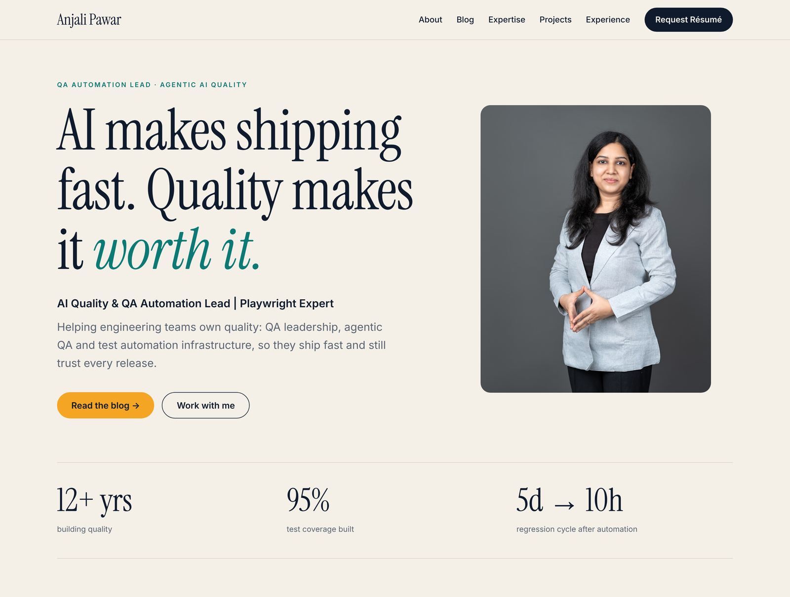

# anjalipawar.com

Personal website and blog of **Anjali Pawar**, AI Quality & QA Automation Lead | Playwright Expert.

Writing and projects on QA leadership, quality ownership, agentic QA and test automation infrastructure.

**Live site:** [anjalipawar.com](https://anjalipawar.com)

---



## What's on the site

- **Hero:** headline, positioning and key numbers
- **About:** career story, with a read-more toggle
- **Blog:** short essays on how quality keeps up with AI, each linked to its LinkedIn discussion
- **Expertise:** skills grouped into focused areas, from test automation to AI evaluation
- **Projects:** hands-on AI quality and automation work, with GitHub links and status tags
- **Experience:** roles from QA Engineer to Founding QA
- **Credentials:** certifications and education
- **Contact:** email, LinkedIn, GitHub and a résumé request

## Built with

- [Astro](https://astro.build): static site generator
- [Tailwind CSS v4](https://tailwindcss.com): styling, with a custom design system in `src/styles/global.css`
- TypeScript: typed content config
- [GitHub Pages](https://pages.github.com) + GitHub Actions: hosting and automatic deploys
- [GoatCounter](https://www.goatcounter.com): cookie-free, privacy-friendly analytics, including clicks on contact and project links
- Custom domain via GoDaddy

## How it was built

Designed and built with AI-assisted development, working with Claude by Anthropic on content, design and code. Every change was checked visually at desktop, tablet and mobile widths with Playwright screenshots before going live.

## Project structure

```
src/
  config.ts          All site content: about, skills, projects, experience
  layouts/           Base layout (nav, footer, SEO) and blog post layout
  pages/index.astro  Homepage
  pages/blog/        Blog index and posts (one Markdown file per post)
  styles/global.css  Design system: colours, type, components
public/              Images, favicon, preview
```

To update content, edit `src/config.ts`. To add a blog post, add a Markdown file to `src/pages/blog/`.

## Local development

```bash
git clone https://github.com/pawar-anjali/pawar-anjali.github.io.git
cd pawar-anjali.github.io
npm install
npm run dev
```

## Deployment

Every push to `master` builds and deploys the site automatically with GitHub Actions.

---

© 2026 Anjali Pawar
